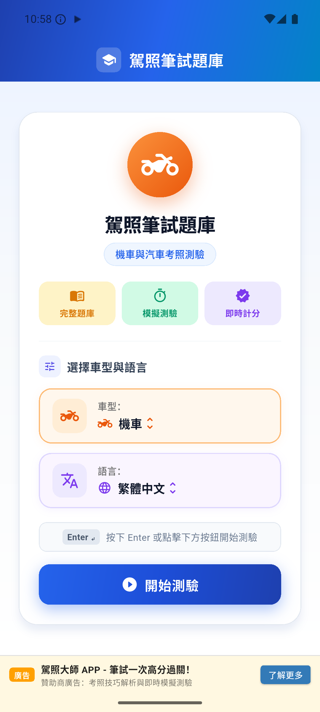
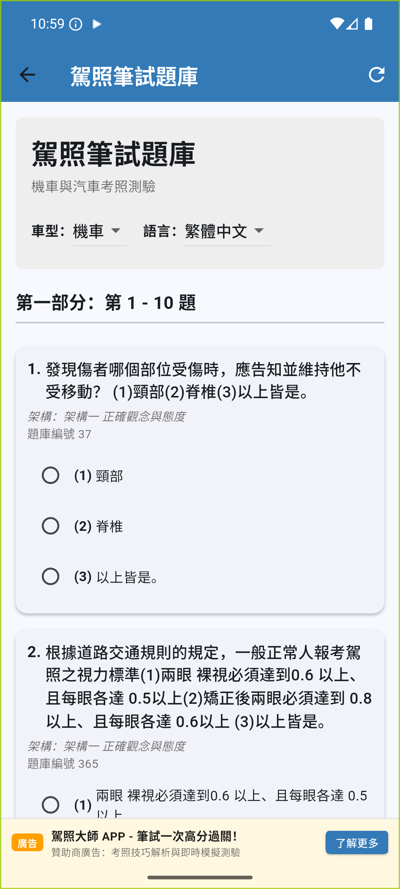
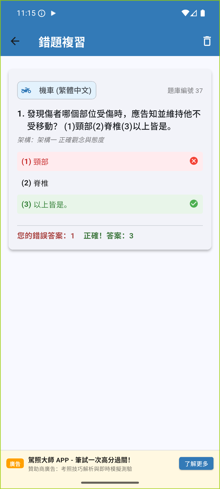
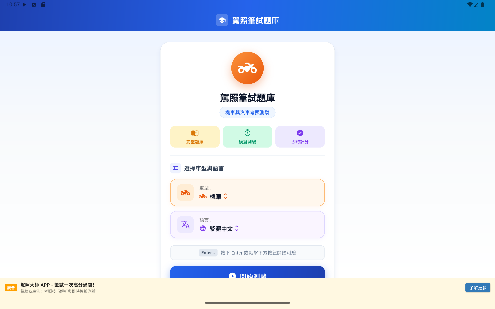
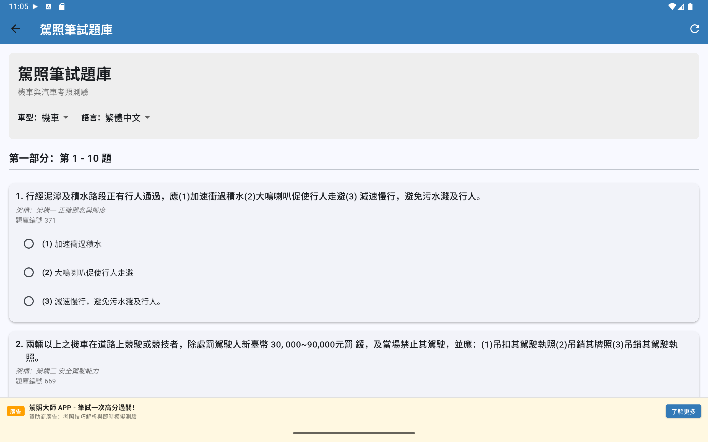
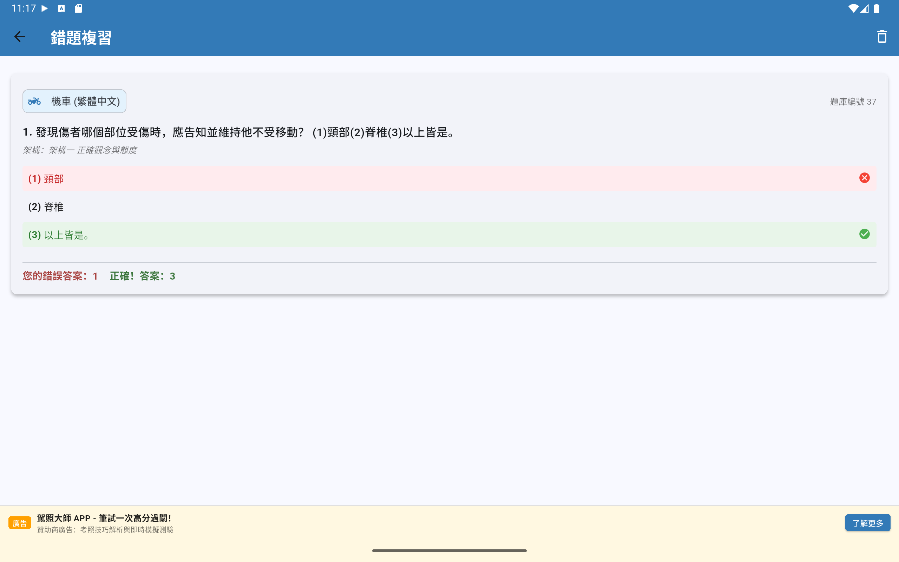

<p align="center">
  
</p>

<p align="center">
  
</p>

<h1 align="center">Driver License Quiz (駕照筆試題庫)</h1>

<p align="center">
  <strong>中華民國交通部公路局汽機車筆試題庫跨平台模擬測驗與練習應用程式</strong>
</p>

<p align="center">
  <a href="https://flutter.dev/"></a>
  <a href="https://dart.dev/"></a>
  
  
  
  
</p>

---

## 📌 專案概述 (Overview)

**駕照筆試題庫（Driver License Quiz，簡稱 `dlquiz`）** 是一款現代、響應式且注重個人隱私的駕照筆試模擬練習應用程式，採用 **Flutter** 與 **Material 3** 框架開發。本專案完整收錄中華民國交通部公路局官方最新汽機車筆試題庫，涵蓋 **機車（806 題）** 與 **汽車（1,090 題）** 之 **繁體中文 (`zh`)** 及 **英文 (`en`)** 雙語版本。

無論您是正在準備台灣的機車駕照還是汽車駕照，`dlquiz` 都能在智慧型手機、平板電腦與桌面電腦等裝置上提供擬真的模擬測驗、自動錯題記錄本（錯題本）以及 100% 離線的流暢學習體驗。


---

## ✨ Key Features

- **🚗 Complete Official Question Banks**
  - **3,792 total questions** extracted directly from official Highway Bureau PDF repositories.
  - Supports both **Motorcycle (機車 - 806 questions)** and **Car (汽車 - 1,090 questions)** in Chinese and English.
  - Multiple formats: **True/False (O/X)** and standard **3-choice Multiple Choice**.
  - Includes all bundled diagrams for road signs, markings, and situational safety scenarios.

- **⏱️ Realistic Exam Simulation**
  - **Dynamic 20-Question Practice**: Generates 20 randomized questions per session divided into two sections.
  - **Completion Validation**: Prevents accidental submissions by identifying unanswered questions.
  - **Standard Scoring**: Evaluates results based on official passing thresholds ($\ge 80\%$, at least 16 / 20 correct answers) with instant answer key comparisons.

- **📖 Persistent Mistake Notebook ("錯題本")**
  - Automatically records incorrectly answered questions to a local **SQLite** database.
  - Review your recorded wrong answers alongside correct answers at any time.
  - Reset or clear records with one tap once topics are mastered.

- **🌐 Bilingual & Instant Locale Switching**
  - Seamless support for **Traditional Chinese (`zh`)** and **English (`en`)**.
  - Switch languages on the fly from the app bar without restarting your quiz.

- **🎨 Tailored Material 3 Design**
  - Vehicle-specific dynamic themes:
    - 🏍️ **Vibrant Orange Theme** for Motorcycle exams.
    - 🚙 **Cool Blue Theme** for Car exams.
  - Fully responsive layout optimized for phones, foldable screens, tablets, and desktops.
  - **Keyboard navigation**: Press `Enter` on the home screen to quickly start practicing.

- **🔒 100% Offline & Privacy-First**
  - No account registration or login required.
  - Zero telemetry, tracking, or network dependencies.
  - Practice records stay strictly inside your device's local sandbox (see [POLICY.md](POLICY.md)).

---

## 📱 Screenshots

### Mobile Experience

| Selection Page | Motorcycle Quiz | Car Quiz | Mistake Notebook ("錯題本") |
| :---: | :---: | :---: | :---: |
|  |  |  |  |

### Tablet & Desktop Layout

| Large Screen Selection | Tablet Quiz Mode | Mistake Review |
| :---: | :---: | :---: |
|  |  |  |

---

## 📊 Question Bank Statistics

| Vehicle Type | Language | Question Count | Question Formats | Assets Included |
| :--- | :--- | :---: | :--- | :---: |
| **Motorcycle (機車)** | Traditional Chinese (`zh`) | **806** | Yes/No (O/X) & Multiple Choice | Sign & Markings Diagrams |
| **Motorcycle (機車)** | English (`en`) | **806** | Yes/No (O/X) & Multiple Choice | Sign & Markings Diagrams |
| **Car (汽車)** | Traditional Chinese (`zh`) | **1,090** | Yes/No (O/X) & Multiple Choice | Sign & Markings Diagrams |
| **Car (汽車)** | English (`en`) | **1,090** | Yes/No (O/X) & Multiple Choice | Sign & Markings Diagrams |
| **Total** | | **3,792** | | |

---

## 🛠️ Tech Stack & Architecture

- **UI Framework**: [Flutter](https://flutter.dev/) (Dart SDK `^3.11.0`, Material 3)
- **Local Persistence**:
  - [`sqflite`](https://pub.dev/packages/sqflite) (Android & iOS)
  - [`sqflite_common_ffi`](https://pub.dev/packages/sqflite_common_ffi) (Linux, macOS, Windows desktop)
- **Internationalization**: Flutter native ARB localization (`flutter_localizations`, `intl`)
- **Dataset Pipeline**: Python 3 (`pymupdf` / `fitz`, `pdfplumber`) for automated PDF question extraction and verification

### Directory Structure

```text
dlquiz/
├── android/                    # Android host project (app.kiddos.dlquiz)
├── google-play-assets/         # Store graphics, icons, and promotional assets
├── lib/
│   ├── l10n/                   # Translation definitions (app_en.arb, app_zh.arb)
│   ├── models/                 # Question, QuizState, and WrongQuestionRecord models
│   ├── pages/
│   │   ├── selection_page.dart # Landing screen (vehicle & language selector)
│   │   ├── quiz_page.dart      # Quiz taker screen & evaluation logic
│   │   └── review_page.dart    # Mistake notebook screen
│   ├── utils/
│   │   ├── database_helper.dart# Cross-platform SQLite manager
│   │   └── question_parser.dart# Question JSON parser
│   ├── widgets/
│   │   └── ad_banner.dart      # Localized banner widget
│   └── main.dart               # App entrypoint, routing, and theme provider
├── questions/
│   └── v2/                     # Extracted question banks and diagram assets
│       ├── car/                # Car questions (en / zh)
│       └── motorcycle/         # Motorcycle questions (en / zh)
├── screenshots/                # Phone and tablet UI screenshots
├── scripts/
│   └── extract_questions_v2.py # Automated PDF extraction script
└── test/                       # Dart unit/widget tests & Python dataset verification
```

---

## 🚀 Getting Started

### Prerequisites

- [Flutter SDK](https://docs.flutter.dev/get-started/install) (version $\ge$ 3.11.0)
- Python 3.12+ (optional, for running dataset verification or PDF extraction)

### Installation & Setup

1. **Clone the repository**:
   ```bash
   git clone https://github.com/your-username/dlquiz.git
   cd dlquiz
   ```

2. **Install Flutter dependencies**:
   ```bash
   flutter pub get
   ```

3. **Generate localization files** (if modifying translation keys):
   ```bash
   flutter gen-l10n
   ```

### Running the App

```bash
# Run on Linux desktop
flutter run -d linux

# Run in Google Chrome
flutter run -d chrome

# Run on a connected Android device or emulator
flutter run -d <device-id>
```

### Building for Release

```bash
# Build Android App Bundle (AAB) for Google Play:
flutter build appbundle --release

# Build standalone Android APK:
flutter build apk --release

# Build desktop binary (Linux):
flutter build linux --release

# Build desktop binary (Windows):
flutter build windows --release

# Build desktop binary (macOS):
flutter build macos --release
```

---

## 🧪 Testing & Validation

### Flutter Tests
Run the comprehensive unit and widget test suites:
```bash
flutter test
```

### Question Bank Integrity Tests
Verify question counts, schemas, and asset file references:
```bash
python3 test/test_extracted_questions.py
```

### Static Analysis & Formatting
```bash
flutter analyze
dart format --output=none --set-exit-if-changed lib/ test/
```

---

## 📜 Privacy & Transparency

`Driver License Quiz` is designed with an **offline-first and privacy-first** philosophy. No personal identifiable information (PII) is ever collected, transmitted, or shared. All question records and mistake notebooks reside solely on your device.

For complete information, please refer to our [Privacy Policy (隱私權政策)](POLICY.md).

---

## 📄 License & Attribution

- **Question Content**: Questions and traffic sign illustrations are sourced from the official public exam banks of the [Directorate General of Highways, Ministry of Transportation and Communications (中華民國交通部公路局)](https://www.thb.gov.tw/).
- **Application Code**: Licensed under the MIT License. See [RELEASE.md](RELEASE.md) for version release notes.
